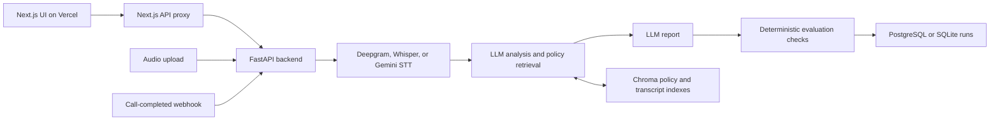

# VoiceScope

VoiceScope is a post-call inspection tool for voice AI calls. It combines transcription, LLM analysis, policy retrieval, and deterministic checks of the resulting evaluation.

The current score measures heuristic consistency of an evaluation. It is **not** a calibrated probability that the call is truthful or compliant. A model flag needs supporting evidence and review. A real Bolna execution has been replayed through recording download, Deepgram transcription, Groq evaluation, and local persistence/reload. Fresh Bolna-originated webhook delivery, retry safety, and durable ingestion remain unverified. See the [live-service verification report](docs/bolna-verification.md).

See the [repository audit and delivery plan](docs/p0-audit.md), [scoring contract](docs/scoring-contract.md), and [demo walkthrough](docs/demo-walkthrough.md).

## Architecture



The transcript API skips STT. Speaker roles are preserved from attributed transcripts and inferred for diarized audio in both regular and streaming flows. The UI distinguishes transcript labels, inferred roles, and unknown roles. See [speaker attribution](docs/speaker-attribution.md). The pipeline supports multiple LLM providers and configured fallback providers. The API also exposes batch processing, monitoring, knowledge entries, QA cohorts, extraction schemas, and feedback. Batch jobs and rate limits use process memory.

## Local setup

Use Python 3.11 or later and Node.js 24 or later for the frontend test command.

```bash
python -m venv .venv
. .venv/bin/activate
pip install -r requirements.txt
pip install pytest pytest-asyncio ruff
cp .env.example .env
```

Edit `.env` locally. Set `VALID_API_KEYS` and the credentials for the LLM and STT providers you select. Keep keys out of commits and screenshots. For transcript-only evaluation, no STT credential is required.

```bash
uvicorn main:app --reload --port 8000
```

Configure the frontend in `frontend/.env.local`:

```dotenv
BACKEND_URL=http://localhost:8000
API_KEY=your-local-voicescope-api-key
```

```bash
cd frontend
npm ci
npm run dev
```

The UI opens at `http://localhost:3000`. FastAPI documentation is at `http://localhost:8000/docs` outside production. Backend requests require `X-API-Key`, except health and documentation routes.

**Access-control limitation:** the frontend currently attaches its server-side API key to proxied requests without authenticating the visitor. Use a private local environment for real call data until frontend authentication and operation permissions are implemented. A hidden backend key alone does not protect this proxy.

## Data and persistence

Set `DATABASE_URL` for PostgreSQL. Without it, stores use SQLite under `DATA_DIR` or their configured paths. The PostgreSQL client currently requires SSL; a local PostgreSQL instance without SSL falls back to SQLite. Database connection failure also falls back to SQLite, which can produce separate datasets across instances.

New runs store the full evaluation and transcript in `runs.evaluation`. Existing databases gain this column during schema initialization. Legacy rows may have only a truncated transcript and cannot recover missing evidence automatically. No production data migration or re-evaluation has been run.

Overview totals come from persisted Runs across all time. Real and synthetic runs have separate counts. Flag rates exclude synthetic runs and incomplete evaluations. Monitoring endpoints still use a time window and a separate metrics table.

## Tests and benchmark

```bash
.venv/bin/pytest -q
.venv/bin/ruff check .
.venv/bin/python scripts/run_benchmark.py --min-truth 0.7 --json /tmp/voicescope-benchmark.json
cd frontend
npm test
npx tsc --noEmit
npm run lint
npm run build
```

The primary [policy detector benchmark](docs/policy-benchmark.md) independently runs the production deterministic detector against 28 manually labeled synthetic cases. The Benchmark page shows expected versus detected findings, source transcripts, precision/recall, and visible misses. Run `.venv/bin/python scripts/run_reliability_benchmark.py --json /tmp/policy-benchmark.json`. Its default all-cases gate currently fails on three challenge paraphrases: 25/28 cases match. Those failures remain visible; this is not production accuracy.

The legacy offline harness benchmark loads ten synthetic labeled transcripts from `core/data/labeled_calls.json`. It checks consistency against supplied fixture answers and does not independently test hallucination detection, STT, or a live LLM. It remains available through `scripts/run_benchmark.py` and the collapsed legacy section of Benchmark. The disconnected optimizer controls have been removed from the page.

Repository-wide Ruff currently reports existing import-order errors in `main.py`, where dotenv loads before application imports. The changed Python modules pass Ruff.

Regression tests cover numeric support, invalid scores, incomplete model output, conflicting evidence, failure states, run summaries, synthetic data, and evaluation persistence. Mocked service tests do not establish live integration success.

## Demo

```bash
.venv/bin/python cli.py demo
```

For the evidence review demo, select **Explore 3 synthetic scenarios** on Overview. This seeds a compliant conversation, a forbidden same-day refund promise, and an explicit supervisor-transfer refusal. Findings are computed from fictional policies and attributed transcripts. Seeding is idempotent and does not activate company policies. Synthetic rows have no fabricated timings, payment results, cost, or quality score and are excluded from real-call counters. The CLI above retains the older heuristic fixtures.

Configure actual company rules in **Settings → Policies** before evaluating real calls. Only two bounded English rule types are supported: no same-day refund guarantees and honoring explicit escalation requests. Reference knowledge does not activate these rules. Each assessment stores the applied policy version and exact transcript quotes. A refund-completion statement without an action result is an **unverified claim**. See [reliability contracts and setup](docs/reliability.md).

## Post-call STT quality

Call detail now includes **STT quality**: retrieve an original Bolna recording for listening, automatically prepare a separate Deepgram pass under workspace authorization or a human-verified reference, and inspect timestamped discrepancies. Human references support WER; automatic references show **estimated transcript disagreement**. Missing timings, ambiguous speakers, absent audio, and provider failures withhold scores. Bolna's stored plain transcript needs manual timing annotations before an aligned rate is possible.

The new recording routes are disabled on the public frontend proxy by default. Enable only in a private, access-controlled environment. See [STT contracts, private setup, APIs, tests, and limitations](docs/stt-quality.md). The [live STT verification](docs/stt-live-verification.md) retrieved a completed real recording and verified actual Deepgram transcription, timestamps, persistence, and reload. Missing Bolna timestamps still prevent an aligned rate.

## Bolna integration status

The existing endpoint is `POST /api/v1/webhooks/call-completed`. The parser recognizes the execution-shaped Bolna payload. The handler uses a nonempty supplied Bolna transcript first, preserving its assistant/user roles. Calls without a supplied transcript use recording download and STT. Evaluations remain synchronous. Source call/agent metadata and role attribution persist with the evaluation. Durable ingestion, deduplication, retry recovery, and complete source metadata handling remain unfinished.

Bolna documents configurable webhook headers and execution-shaped payloads in its [webhook guide](https://www.bolna.ai/docs/post-call/polling-call-status-webhooks) and [Get Execution API](https://www.bolna.ai/docs/api-reference/executions/get_execution). Configure credentials securely on the backend; never paste them into a transcript or commit them. An existing completed execution has verified local replay and live-service processing. Fresh Bolna-originated delivery to production remains unverified.

## Deployment

The frontend uses Next.js and is deployed separately on Vercel. The backend Dockerfile starts Uvicorn and honors `PORT`. `railway.toml` specifies the health endpoint and a data volume. Docker Compose includes PostgreSQL and local data storage. Review the SSL limitation above before relying on Compose database persistence.

Production needs a private backend configuration, durable storage, frontend authentication, safe recording downloads, and a durable worker before real ingestion can be described as reliable. No deployment, secret change, or infrastructure change is part of the current local milestone.

## Known limits

- Deterministic policy detection covers explicit English patterns for two supported rule types. No matches do not establish overall compliance. Arbitrary policy prose and semantic paraphrase detection are unsupported.
- Policies use a local SQLite store (`POLICY_DB_PATH`, otherwise `DATA_DIR/policies.db`) even when run storage uses PostgreSQL. This is a single-workspace implementation without tenant isolation.
- Numeric support checks presence and currency, not attribution, negation, time ordering, or whether two values refer to the same entity.
- Citation, sentiment, outcome, and escalation checks are heuristics. They can require review on valid calls.
- Quality scores are LLM judgments. They have range validation but are not calibrated.
- A refund claim in a transcript does not prove a successful refund tool result. Tool evidence is not currently verified.
- Existing persisted negative scores require re-evaluation. This milestone does not rewrite historical or production records.
- Recording redirects, public proxy permissions, tenant isolation, storage fallback, and in-memory jobs need work before handling customer data.
- The optimizer does not establish better detection accuracy; its weights are not wired into the main validation score.

Licensed under [MIT](LICENSE).
